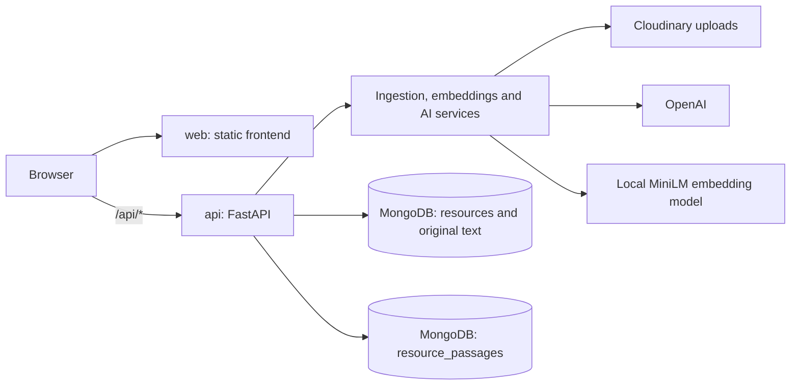

# Architecture and deployment decisions

Keep one repository with two independently runnable applications. The `web` service
builds the React/Vite frontend; the `api` service runs Python/FastAPI. These names
are deployment identifiers; their source roots are `frontend/` and `backend/`.

## Routing and access

Root `vercel.json` routes `/api/*` to `api`, and all remaining paths to `web`.
The wrapper `backend/vercel_app.py` mounts the existing API at `/api`; standalone
hosts still run `app.main:app` without a prefix. Frontend deep links `/ask` and
`/submit` resolve to the SPA's index page.

There are no internal service bindings: requests originate in the browser, not
in a frontend server function. Use the public relative URL `/api` in the combined
deployment. Database and provider credentials remain backend settings; `VITE_*`
variables are public. Both services are publicly reachable, regardless of the
frontend's live-mode flag. Deletion, passage reprocessing and index administration
require the existing admin bearer token;
expensive endpoints use shared database-backed quotas. Per-user ownership is
not yet implemented.

## Runtime trade-offs

Vercel Services is Beta. Start with one combined deployment to reduce setup work,
then verify the real Python bundle size, memory and cold-start performance.
The backend installs CPU-only PyTorch on Linux through uv. MiniLM loads lazily
and uses ephemeral temporary storage on Vercel; it can download again on a new
instance. The embedding model and existing vector format are unchanged.

Documents preserve extracted pages and are split into overlapping, token-bounded
passages before embedding. A separate vector index searches these excerpts;
generated summaries remain a labeled fallback for unmigrated resources and other
media. Passage revisions are published by atomically switching the parent pointer,
and retrieval joins that pointer so staged/stale or deleted resources cannot appear.
See [passage retrieval](passage-retrieval.md) for setup, admin reprocessing, bounded
request-time limits and the crash-cleanup limitation.

Vercel uploads are capped at 4 MB to allow multipart overhead below the function's
4.5 MB request-body limit. A future larger-file flow should upload directly to
storage using server-authorized uploads, then enqueue processing of the stored
object. Do not send Cloudinary's API secret to the browser.

Processing currently runs in a thread pool within the HTTP request. This avoids
blocking the async event loop but does not make work durable. Step 3 still needs
persistent job/status records, deduplication, a worker, and safe retries. Keep
those operations in `app/services/` so a worker can reuse them without importing
HTTP routes. Choose the worker runtime when implementing that feature; the
repository does not require every runtime to use the same hosting provider.

## Local development and checks

Run the applications separately using their READMEs, or run `vercel dev` from the
repository root with the Vercel CLI and service dependencies installed. Separate
local apps use an absolute API URL; the combined deployment uses `/api`.

CI runs backend tests with mocked external services, plus frontend tests, lint
and a production build. These checks do not validate production credentials,
MongoDB network access/vector indexes, AI availability, or hosted ML performance.
The root README documents the remaining live checks and environment variables.

References: [Services](https://vercel.com/docs/services),
[bindings](https://vercel.com/docs/services/bindings),
[function limits](https://vercel.com/docs/functions/limitations).
