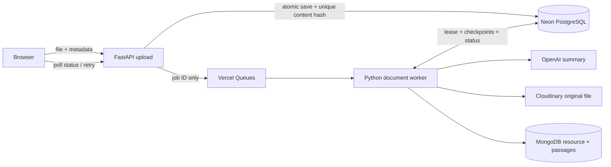

# Reliable document ingestion (milestone 3)

PDF, DOCX and TXT uploads can now be accepted as durable jobs. Images, articles
and video links continue using their existing processing path. The site remains
a **shared public library**; this change does not add accounts or private uploads.
Do not use it for confidential documents. If accounts are introduced, add verified
ownership to uploads, job status/retry, resource reads/deletes and vector retrieval;
never accept an owner ID supplied by the browser as authorization.

## Architecture



PostgreSQL stores the processing lifecycle, original upload while pending, and
completed-stage checkpoints. MongoDB stays the searchable library; this is not
a database migration. Vercel's private queue subscriber runs separately from the
HTTP upload request. No Redis, always-on Railway service, or FastAPI background
task is required. Queues is a beta platform dependency.

## Enable on Vercel

1. Connect a dedicated **Neon** database through the project's Storage page.
   The integration supplies the backend `DATABASE_URL`. Use a pooled connection
   in the same region as the API. For a separate database URL use
   `INGESTION_DATABASE_URL`; it overrides `DATABASE_URL`.
2. Deploy the code with `DOCUMENT_INGESTION_ENABLED` unset/false. The existing
   upload behavior remains available until activation. The Python subscriber
   entrypoint is registered in `backend/pyproject.toml`.
   The API service must use `entrypoint: "pyproject.toml"`; `[tool.vercel]`
   declares the web app and `[[tool.vercel.subscribers]]` declares the worker.
   A direct `vercel_app:app` service entrypoint builds only the web function,
   silently omitting subscribers in Services mode.
3. Run `python -m scripts.ingestion migrate` from `backend` with the database URL
   in your private environment. Alternatively, send an authenticated POST to
   `/api/admin/ingestion/setup` using the existing `RESOURCE_ADMIN_TOKEN`.
   Setup is additive and safe to repeat; it does not modify MongoDB resources.
4. Set backend `DOCUMENT_INGESTION_ENABLED=true`, `INGESTION_DISPATCH=vercel`, and
   a random `CRON_SECRET` (at least 32 bytes). Redeploy. Do not prefix secrets
   with `VITE_`, copy them into frontend code, or commit them.
5. Confirm the Vercel deployment contains the private `app.ingestion_subscriber`
   worker. The root configuration schedules daily reconciliation. A job can
   also be redispatched by its retry button, the admin reconciliation endpoint,
   or `python -m scripts.ingestion reconcile`.
6. Upload a small original TXT/PDF, observe queued → processing → succeeded,
   then ask a question with evidence unique to the file. Upload identical bytes
   again and confirm the resource count does not increase.

Keep production and preview ingestion databases separate before enabling preview
uploads. The activation flag is backend-only, so the browser cannot bypass it.
If disabled for rollback, new uploads use the legacy synchronous path; pause
uploads first if preserving cross-path deduplication is essential.

## API behavior

- `POST /upload`: documents return **202** plus `job_id`, `status`, `title`,
  `retry_available`, `attempts`, and a safe `error`. The original upload is already
  durable before acknowledgement. Existing completed legacy resources with a
  stored source hash can return the normal resource response instead.
- `GET /ingestion/{job_id}`: current public status, with caching disabled. Input
  bytes, extracted text, checkpoints, hashes and worker tokens are never returned.
- `POST /ingestion/{job_id}/retry`: requeues eligible jobs without reuploading.
  Uses the same server usage allowance; an active job cannot be reset.
- `POST /admin/ingestion/reconcile`: admin-only redelivery of outstanding jobs.
- `GET /internal/ingestion/reconcile`: scheduler-only, requires `CRON_SECRET`.

All paths are prefixed with `/api` on Vercel. The browser stores only the latest
job ID in session storage so refreshing/returning in the same tab resumes status.
The status URL `/submit?job=<job_id>` can also be bookmarked; it is a public status
page for this shared library, not an authorization mechanism for private documents.
Successful processing means the document and passages were saved; Atlas may take
a short time to index them for retrieval.

## Reliability guarantees and boundaries

- A PostgreSQL unique constraint on the SHA-256 of the file bytes prevents
  concurrent/repeated submissions from creating multiple jobs. Metadata from the
  first submission wins. This is byte-level deduplication, not semantic similarity.
  Historical documents without a saved source hash cannot be deduplicated reliably.
- Workers claim with `FOR UPDATE SKIP LOCKED`, use a five-minute lease, heartbeat
  every 30 seconds, and fence checkpoint/publication by a per-attempt token. A
  crashed worker can be reclaimed. Each attempt has a 210-second processing budget.
- Parsing/embedding, summary, summary embedding and final storage are checkpointed.
  Retries reuse saved results. A provider call that succeeded just before a crash
  but before its checkpoint may run again: **API charges are not exactly-once**.
- Cloudinary uses a stable per-job public ID with overwrite disabled. Mongo resource
  IDs, passage IDs and revisions are stable, and publication uses insert-only
  upserts. Partial writes/lost acknowledgements can be replayed without extra
  resources or passage results. The parent is published after all passages exist.
- Deletion commits a PostgreSQL cancellation tombstone before MongoDB deletion.
  A minimal MongoDB tombstone is also retained, hidden from library/count/search
  endpoints. It blocks late insert-only upserts even if a worker's PostgreSQL
  connection is lost during publication, preventing retries resurrecting files.
  Reuploading the same deleted bytes returns the cancelled job; restoration is an
  administrative decision, not an automatic retry. Cloudinary asset deletion is
  not part of resource deletion.
- Empty/unreadable/unsupported/oversized documents fail clearly. Permanent failures
  offer no retry. Temporary failures automatically retry for up to three attempts;
  users can request further attempts up to five total. Crashes count toward the cap.
- Queue notification failures do not lose uploads. The daily reconciler catches
  unnotified jobs and expired delivery messages; manual retry can recover sooner.
  This is bounded eventual recovery, not a promise of immediate processing.
- Source bytes are limited to 4 MB on Vercel (10 MiB elsewhere). They are held in
  PostgreSQL intentionally for atomic admission at this small scale, then cleared
  on success or permanent parsing failure. Abandoned inputs/checkpoints expire
  after seven days during reconciliation; small dedup/status records are retained.
  For larger volume, move staged bytes to private object storage with an outbox.
- Limits count accepted uploads/retry requests; bounded automatic worker retries
  do not reserve another public request. This is not a dollar spending cap.

## Local worker and tests

Set `DOCUMENT_INGESTION_ENABLED=true`, `INGESTION_DISPATCH=poll` and a private
PostgreSQL URL in `backend/.env`, then run:

```sh
python -m scripts.ingestion migrate
python -m scripts.ingestion worker
```

Run API/worker unit tests with `python -m pytest -q tests`. Real concurrency tests
run separately with `TEST_DATABASE_URL` pointing at a **disposable test database**:
`python -m pytest -q integration_tests`. They create/drop isolated test schemas,
exercise simultaneous uploads/claims, lost acknowledgements, stale workers,
checkpoint reuse, cancellation and crash attempt limits. GitHub Actions supplies
PostgreSQL 17 for this suite. Frontend tests cover status, retry, errors and reload.

References: [Vercel Python subscribers](https://vercel.com/docs/queues/python-sdk),
[PostgreSQL row locking](https://www.postgresql.org/docs/current/sql-select.html),
[Cloudinary upload options](https://cloudinary.com/documentation/image_upload_api_reference#upload).
